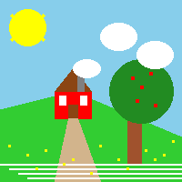
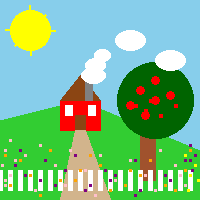
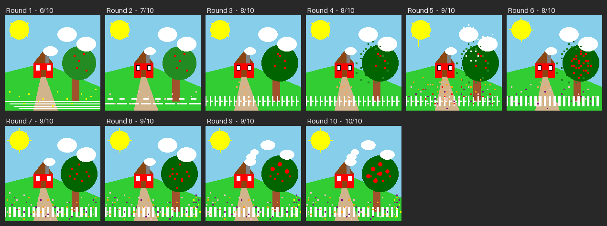

# Painter & Critic: a multi-agent drawing system with Google ADK

Two agents work together to make a drawing. The **Painter** draws on a 200x200 canvas by calling drawing tools. The **Critic** looks at the resulting image and gives feedback. They take turns in rounds until the Critic is satisfied, or 30 rounds have passed. Both agents use the Gemma4 26B model on Lehmus AI through ADK's LiteLLM integration.

<p>
  
  &nbsp;→&nbsp;
  
</p>

*Round 1 and round 10 (the final image) of the submitted run.*



*All 10 rounds of the submitted run, with the score the Critic gave each one.*

## Subject prompt

This is the subject I chose. It is set in `painter_critic/config.py` (`SUBJECT`) and can be changed with `--subject`:

> A cozy countryside scene. A small red house with a brown triangular roof stands on a rolling green hill. The house has a wooden door, two windows with white frames, and a grey chimney with a puff of smoke. A light brown dirt path leads from the door down to the bottom of the picture. To the right of the house stands a tree with a brown trunk and a round green crown with a few red apples. A white picket fence runs along the bottom, small colorful flowers dot the grass, and in the blue sky there is a yellow sun with short rays and two white clouds.

I started with a much simpler version (just a house, a tree, a sun and a hill). The Painter got that almost right in the first round, so there was very little left to improve. The richer subject has enough detail that the improvement over the rounds is easy to see.

## How to run

**You need:** Python 3.11 or newer, and the University of Oulu network or VPN (the Lehmus API is only reachable from there).

**1. Set up the environment**

```bash
python -m venv .venv
# Windows:
.venv\Scripts\activate
# macOS / Linux:
source .venv/bin/activate

pip install -r requirements.txt
python -c "import google.adk; print(google.adk.__version__)"   # should print 2.14.1
```

**2. Add the API key**

Copy `.env.example` to `.env` and put the Lehmus API key after `LEHMUS_API_KEY=`. `LEHMUS_API_BASE` and `LEHMUS_MODEL_ID` can stay empty. The code then uses `https://api.lehmus-ai.oulu.fi/v1` and `wnofibsjlomanbprgbdp` by default.

**3. (Optional) Check the connection to the model**

```bash
python scripts/smoke_test.py
```

This checks that the model answers text, understands an image, can call a tool, and sees an image that is added by a callback. All four should print `PASS`.

**4. Run the drawing session**

```bash
python main.py
```

The whole conversation is printed to the console. Each run writes to its own folder, `output/run_YYYYMMDD_HHMMSS/`:

- `round_001.png`, `round_002.png`, … : the canvas after each round
- `conversation_log.md` : the full Painter/Critic conversation, with every tool call, each round's image and the Critic's reviews

A run usually takes 2–5 minutes. The model's answers differ from run to run, so every run produces a different drawing and a different number of rounds.

Options:

```bash
python main.py --max-rounds 5                                    # shorter test run
python main.py --subject "A red sailboat on a calm blue sea"     # another subject
python main.py --output-dir output/my_run                        # choose the folder
```

To make an overview image of all rounds (like the one above):

```bash
python scripts/make_contact_sheet.py output/run_YYYYMMDD_HHMMSS
```

**5. (Optional) Unit tests**

```bash
python -m pytest
```

The 61 tests cover the canvas, the tools, the callbacks and the log writer. They do not need the network or an API key.

## What is in the repository

| Path | What it is |
|---|---|
| `main.py` | Starts one drawing session: creates the session and runner, runs the loop once, writes the log |
| `painter_critic/agent.py` | The two `LlmAgent`s and the `LoopAgent` |
| `painter_critic/prompts.py` | The Painter's and the Critic's instructions |
| `painter_critic/tools.py` | The six drawing tools |
| `painter_critic/canvas.py` | The 200x200 canvas (Pillow): saving PNGs, the grid view shown to the models |
| `painter_critic/callbacks.py` | ADK callbacks: showing the image to the agents, counting rounds, saving images, safety checks |
| `painter_critic/transcript.py` | Turns ADK's events into the console output and `conversation_log.md` |
| `painter_critic/config.py` | Subject, canvas size, limits, model settings |
| `scripts/` | `smoke_test.py` (model check), `make_contact_sheet.py` (overview image) |
| `tests/` | Unit tests |
| `results/` | **The submitted run**: `round_001.png` … `round_010.png`, `conversation_log.md`, `progression.png` |

## Design

### Pattern: a generator–critic loop

```
LoopAgent "painter_critic_loop"  (max_iterations = 30)
 ├── painter  (LlmAgent, 6 drawing tools)   → draws, round image saved as round_NNN.png
 └── critic   (LlmAgent, exit_loop tool)    → reviews the image, feedback stored in session state
```

The task is a classic generator–critic setup: one agent produces something and the other judges it, over and over. ADK's `LoopAgent` fits this exactly. It runs its sub-agents in order (Painter, then Critic), and one iteration of the loop is one round. `max_iterations=30` gives the 30-round limit, and the Critic ends the loop early by calling ADK's built-in `exit_loop` tool.

`main.py` calls `runner.run_async(...)` **once**. All the rounds happen inside ADK, so there is no Python loop that calls the agents. (ADK 2.14.1 prints a deprecation warning for `LoopAgent` because it will be replaced by `Workflow`. The assignment allows `LoopAgent` since the version is pinned, so I suppress that one warning.)

I chose `LoopAgent` over a `Workflow` because the flow is a simple fixed cycle with one exit condition, so there were no branches that a workflow graph would help with.

### The two agents

Both are `LlmAgent`s with the same model and clearly separated roles:

- **Painter**: "a digital artist who draws by calling tools". Its instruction contains the subject, how the coordinates work, the Critic's latest feedback, and its own drawing history (see below). In round 1 it plans the whole picture and draws it background first, then large shapes, then details. In later rounds it carries out the Critic's "next steps". At the end of each turn it writes a short summary of what it changed.
- **Critic**: "an art teacher who evaluates a drawing and does not draw". It must answer in a fixed format, so the feedback is always structured and actionable:

  ```
  Score: x/10
  What works well:      ...
  What should change:   ... (with positions)
  Next steps for the Painter: 2–5 concrete actions with tool names, coordinates, colors
  Decision: CONTINUE or STOP
  ```

  It also gets a scoring guide, so the scores mean the same thing from round to round, and clear rules for when to stop (all parts of the subject recognisable, nothing misplaced, score 8 or higher, no real problems left).

The instructions are written as Python functions (ADK "instruction providers"), so they can include the current round number, the feedback and the history from session state.

### How the agents see the image

Both agents get the real rendered image, not a description of it. A `before_model_callback` adds the image to every model request as a `google.genai.types.Part` with `inline_data` (PNG). LiteLLM turns that into the OpenAI-style image message that the Lehmus API expects.

- The **Painter** sees the current canvas before *every* step, so it can check the result of its own tool calls during its turn. The image is enlarged 3x and has a light coordinate grid with labels every 40 pixels. This way the Painter can read where things are instead of guessing coordinates.
- The **Critic** gets up to three images: the saved `round_NNN.png` file (enlarged, without the grid) to judge the drawing, the same image with the grid to name positions, and the previous round's image to see whether the last changes helped.

The saved round images themselves are plain 200x200 PNGs.

### How the feedback gets to the Painter

The Critic has `output_key="critic_feedback"`, so ADK stores its review in session state. The Painter's instruction includes that text in the next round. Both agents use `include_contents="none"`, which means they don't receive the whole history of earlier rounds. Everything they need (instruction, latest feedback, current image) is given to them directly. Without this, 30 rounds of images and tool calls would make the requests very large.

### Tools and why

The Painter has six tools. Each one draws many pixels per call, so every call makes visible progress:

| Tool | Used for |
|---|---|
| `fill_background(color)` | the sky; also starts a redraw (see below) |
| `draw_rectangle(x1, y1, x2, y2, color)` | walls, door, windows, ground |
| `draw_ellipse(x, y, radius_x, radius_y, color)` | sun, tree crown, clouds, smoke, apples |
| `draw_polygon(points, color)` | roof, hills, path |
| `draw_lines(lines, color, width)` | many strokes at once: all fence posts, all sun rays, trunks |
| `draw_dots(points, color, dot_size)` | many small things at once: flowers, apples, texture |

Colors can be names (`"forestgreen"`) or hex codes. A tool never crashes on bad input. It returns an error message instead (e.g. `"unknown color 'darkbrown'"`), so the model can read it and fix its next call. Coordinates outside the canvas are moved to the edge instead of being rejected, because the model often wrote 200 instead of 199.

**Redrawing instead of erasing.** The tools can only paint on top, and there is no eraser. Early on, when the Painter had to move something, it painted over the old shape with "background color". This left patches everywhere and the drawing got worse every round. So now the canvas remembers every drawing command since the last `fill_background`, and the Painter sees that list. To move, resize or remove something, it starts over with `fill_background` and replays the list with the corrections. To only add things (more flowers, the rest of the fence), it just draws on top. The Critic is told which of the two to ask for.

### Callbacks and safety checks

The model is not perfectly reliable, and several problems only showed up in real runs. I handled them with ADK callbacks:

| Callback | What it does | Why |
|---|---|---|
| Painter `before_agent_callback` | starts a round: round counter, per-round limits, freezes the drawing history | |
| Painter `before_model_callback` / Critic `before_model_callback` | adds the canvas image(s) to the request | the agents must see the image |
| Painter `before_tool_callback` | at most 40 tool calls and one `fill_background` per round | the Painter once got stuck calling `fill_background` again and again |
| Painter `after_agent_callback` | saves `round_NNN.png` | one image per round, always |
| `after_model_callback` (both) | if a tool call arrives as plain text (`<|tool_call>call:draw_polygon {...}<tool_call|>`), turns it back into a real tool call | this happened in the middle of redraws: ADK took the text as the final answer, the turn ended, and the canvas was left almost empty |
| Critic `after_model_callback` | if the Critic writes "Decision: STOP" but forgets to call `exit_loop`, adds the `exit_loop` call | Gemma often writes STOP without the tool call, so the loop kept going against the Critic's own decision. The decision is still the Critic's. ADK then runs its normal `exit_loop` tool |

Every time one of the two `after_model_callback`s steps in, the log says so in a note, so you can see in `conversation_log.md` exactly when it happened.

### How I got here

I tested with short runs first, then four full runs. Each run showed a different problem:

| Run | Rounds | Ended by | Scores | Problem I found → what I changed |
|---|---|---|---|---|
| 1 | 20 | Critic | 6→9, but dropped to 1 in rounds 7 and 13 | tool calls arriving as text ended the Painter's turn mid-redraw → recovery callback |
| 2 | 30 | 30-round limit | up to 9, then slowly down to 2 | redraws needed more than 40 tool calls (each fence post and sun ray was a separate `draw_line`), so the fence was always cut off. The Critic also asked for full redraws just to add things. → `draw_line` became `draw_lines`, plus clear "add on top vs. redraw" rules. The model also kept leaving out `center_y` in `draw_ellipse`, so I renamed the parameters to `x`/`y` |
| 3 | 8 | Critic | 6→9 | no new problems |
| 4 | 10 | Critic | 6→10 | no new problems: **this is the submitted run** (`results/`) |

## Observations on the output images

These are about the submitted run (`results/`), plus what I saw in the other runs.

**What went well**

- **The drawing clearly improves with the feedback.** The best example is the fence. In round 1 it was a few horizontal lines, in round 2 dashed lines, from round 3 on real vertical posts, and in round 6 the posts became even and solid. Other improvements came one by one when the Critic asked for them: sun rays, flowers in several colors (round 5), a darker, more natural tree crown, chimney smoke as several puffs, and bigger round apples (rounds 9–10).
- **The Critic really looks at the image.** In round 2 the Painter wrote in its summary that it had drawn vertical fence posts, but the picture still showed horizontal dashes. The Critic said exactly that ("the painter drew horizontal white lines instead of vertical posts"). Its comments about positions and leftover marks match what is actually in the pictures.
- **Mistakes get caught and fixed.** In round 5 the Painter added white and dark green specks around the tree crown as "texture", and a single long yellow line hanging from the sun. The Critic flagged both. The sun got proper rays and the white specks were gone in round 6, and the remaining green specks were removed in round 7.
- **The composition stayed stable** once it was right. Thanks to the "copy unchanged commands exactly" rule, a redraw usually only changed what the Critic asked for.

**What went wrong or stayed weak**

- **The window frames never worked.** The subject asks for white frames on the windows. The Painter drew black frames in rounds 2–6, and from round 7 on the windows were plain white blocks again, without the Critic noticing.
- **The style stays simple and flat.** Everything is built from basic shapes, with no shading or perspective. The path didn't really get the texture the Critic asked for early on. With these tools and this model, the drawings look like a neat children's illustration.
- **The Critic is a bit generous at the end.** It gave 10/10 in round 10 while the window frames were missing and a few small square "apples" from earlier rounds were still visible next to the new round ones. Its scores also go up and down by about 1 point between rounds even when little changes (e.g. 9 → 8 → 9).
- **The Painter doesn't always use `draw_lines` efficiently.** In the submitted run it drew all fence posts with one call. But in a later test run it made 19 separate `draw_lines` calls with one line each during a full redraw, ran into the 40-calls-per-round limit, and left the redraw unfinished (score 7 → 5). The limit keeps the run going, but a round is lost when this happens.
- **The model makes small tool-call mistakes.** For example, it sometimes gives `draw_lines` [x, y] pairs instead of [x1, y1, x2, y2]. These cost one call each, because the tool returns an error and the Painter fixes it on the next call.
- **In the other runs:** before the fixes above, whole rounds could be ruined, with an almost empty canvas (run 1) or an unfinished fence round after round (run 2). The Critic then usually needed 3–5 rounds to get the drawing back to its earlier quality.

## Deliverables

- Source code: this repository (`main.py`, `painter_critic/`, `scripts/`, `tests/`), with pinned versions in `requirements.txt` (`google-adk==2.14.1`, `litellm==1.109.1`)
- Images from all rounds of the submitted run: `results/round_001.png` … `results/round_010.png`
- Full conversation log of the submitted run: `results/conversation_log.md`
- Overview of all rounds: `results/progression.png`

## Use of AI
This assignment's planning, coding, and structuring the README was assisted by Claude Code. Multiple system running decisions (fine-tuning) during the development of the system was made by the author.
